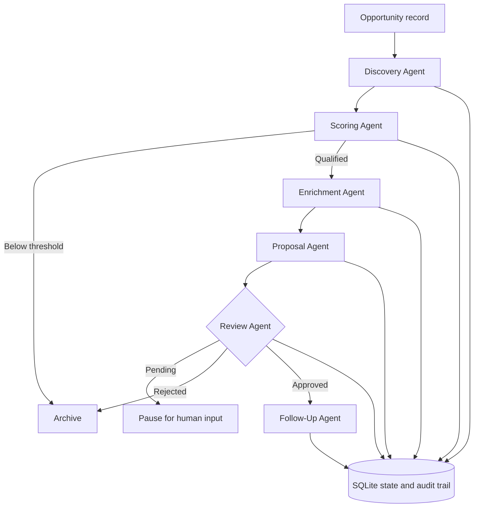

# Multi-Agent Opportunity Intelligence Workflow

A sanitized, reproducible portfolio edition of the workflow behind MAGNATUM's opportunity-intelligence process. It shows how specialized Python agents can collect and normalize opportunities, score business fit, enrich context, draft a proposal, pause for human review, and schedule follow-up while keeping an auditable state in SQLite.

The design is deliberately hybrid:

- deterministic rules handle normalization, routing, scoring, validation, and scheduling;
- an optional provider-agnostic LLM adapter can assist enrichment and proposal refinement;
- a human must approve or reject the proposal before follow-up is created.

This is not presented as an autonomous agent swarm. It is an **AI-assisted multi-agent workflow with bounded responsibilities and explicit controls**.

## Architecture



The six agents are:

1. **Discovery Agent** — validates, normalizes, and assigns a stable identifier.
2. **Scoring Agent** — applies explainable pain, fit, and contact rules.
3. **Enrichment Agent** — builds evidence-grounded context; optionally calls an LLM.
4. **Proposal Agent** — creates a structured draft; optionally asks an LLM to refine it.
5. **Review Agent** — records pending, approved, or rejected human decisions.
6. **Follow-Up Agent** — creates Day 3 and Day 7 follow-up actions only after approval.

See [the architecture notes](docs/architecture.md) for state transitions and design trade-offs.

## Quick start

```bash
python -m venv .venv
python -m pip install -e .
python -m unittest discover -s tests -v
python -m magnatum_workflow.demo --auto-approve
```

The demo uses fictional records from `sample_data/opportunities.json` and writes a local SQLite file under `.local/`.

## Optional AI provider

The default demo is deterministic and needs no API key. To exercise the AI-assisted path, configure an OpenAI-compatible chat-completions endpoint with the variables in `.env.example`, then instantiate `OpenAICompatibleAssistant` and pass it to `WorkflowEngine`.

The adapter requests structured JSON and validates the result. It never sends email, applies to jobs, or performs an external side effect.

## Verification

The test suite covers:

- stable normalization and identifiers;
- explainable scoring and discard routing;
- pending human review as the safe default;
- approval before follow-up generation;
- deterministic fallback when no LLM is configured;
- optional assistant usage without invented contact details;
- SQLite state and audit persistence.

GitHub Actions runs the same standard-library test suite on every push.

## Privacy and scope

This repository contains only fictional sample data. It intentionally excludes production credentials, real contacts, outreach history, operational databases, logs, and private campaign material.

Copyright © 2026 Esteban Barrera Navarro. No license is granted for commercial reuse.

